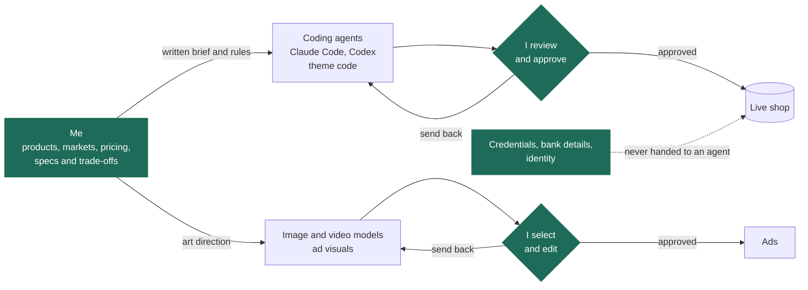
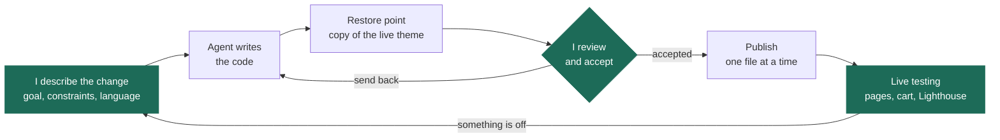
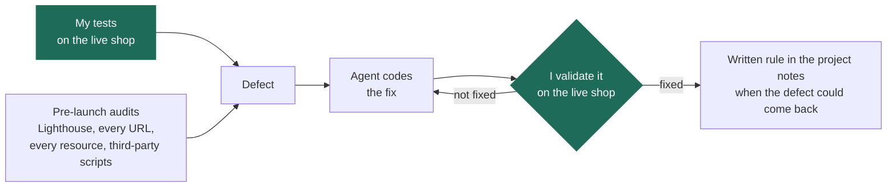

# Hi, I’m Paul

I turn everyday needs into practical web applications, with a focus on clear interfaces, useful features and deployable products.

I’m looking for opportunities where I can contribute to digital products and keep developing my technical skills. My personal projects combine product exploration, hands-on iteration and AI-assisted development.

## Featured project — Sightline

**A Counter-Strike 2 demo analysis platform, in production for my esports team.**

Import match demos and get a 2D and 3D replay, team and player analytics, scouting reports and an AI assistant that answers questions about the team's own matches.

[Explore the project and source code →](https://github.com/BoooJ/sightline)

- FastAPI (Python) backend that parses demos into 32 Hz replays, SQLite with migrations, Docker deployment.
- React and TypeScript interface, with a WebGL (three.js) 3D replay: maps exported from the game, animated player models and ragdoll physics computed in a Web Worker.
- AI assistant (Claude or Gemini) grounded on the team's match data.
- Integrations: n8n automations, a Chrome extension, a TeamSpeak plugin in C++ and a mobile app.
- 1,400+ automated tests, run in CI on every push.

**My role:** defining the product with my team, prioritizing features and directing the work with AI coding assistance (specs, test-first plans, independent reviews), then deploying and running it in production. The repository explains the architecture and how it was built.

## Featured project — Mangathèque

**A self-hosted manga reader for my household, installable on iPhone, iPad and PC.**

Search a public manga catalogue, read in manga (right-to-left), page or vertical-scroll mode, download chapters to read offline in airplane mode, and export them as CBZ or PDF. Each family member has their own account and their own downloads.

*Private repository — I'm happy to walk through the code and architecture on request.*

- SvelteKit 2 and Svelte 5 in strict TypeScript, Node 24 and SQLite, packaged as a Docker image and served over HTTPS behind Caddy.
- Deployed on a VPS that already runs another production app: verified backups, config validation before reload and a before/after state check, so that app never went down.
- A server-side proxy that plays fair with the content API: rate limiters, automatic pause when asked to slow down, a circuit breaker and a size-capped image cache.
- Installable PWA: service worker, per-user offline downloads in IndexedDB that resume where they stopped.
- CBZ and PDF exports streamed page by page, to stay within a 512 MB memory limit.
- Security by default: scrypt password hashing, `__Host-` session cookies, login rate limiting and a strict Content Security Policy.
- About 600 unit tests (Vitest) and end-to-end browser tests (Playwright) against a fake API server, so no test ever hits the real service.

**My role:** defining the need and taking every product decision, then directing an AI-driven workflow end to end: a design document checked by six independent AI reviewers, a shared contract and a 14-task test-first plan (about 350 steps), one coding agent per task followed by an independent review agent, and a step-by-step production deployment run from my own machine, with the server keys never leaving it.

## Featured project — Caderno

**A personal Portuguese-learning notebook, inspired by life in Brazil.**

Translate between French and Brazilian Portuguese, save useful vocabulary, add personal notes and look up verb conjugations from a mobile-friendly interface.

[Explore the project and source code →](https://github.com/BoooJ/caderno)

- React and TypeScript interface, designed for mobile and desktop.
- Express API and persistent SQLite storage.
- 60 built-in verbs, custom verb imports and notebook export.
- PWA with offline reading of previously loaded content.
- Automated tests and a Docker deployment setup.

**My role:** defining the problem, shaping the product, prioritizing features and iterating on the result with AI coding assistance. The repository explains the implementation, trade-offs and current limitations.

## Featured project — AI-built e-commerce shops

**Shopify dropshipping shops whose code and visuals are produced by AI, with every release still under my control.**

Since August 2026 I have been launching Shopify shops on small European markets, in languages I do not always speak. AI coding agents write the theme code and image and video models produce the ad visuals. I decide what gets built, review and test every release, and run the shops.

*Private work — products, suppliers, pricing and the marketing playbook are intentionally left out. The diagrams below show how the work is organised and checked.*

**How the agents are organised** — the steps I never delegate are in green.

**The release loop** — every batch is logged: state before, state after and the command to roll back.

**How changes are verified**

- Working rules written for the agents: nothing goes live without my approval; one file at a time, so the shop settings are never overwritten; a full copy of the live theme before every batch; nothing private in the files served; credentials, bank details and identity handled by me alone.
- What testing caught: images broken on a translated version (the translation tool was renaming file names stored in text settings), a language choice overridden by automatic detection, a cart that reloaded the whole page after a server error, and personal data re-inserted into an auto-generated legal page. Each one was fixed by the agent and validated by me on the live shop.
- Pre-launch audit: 29 URLs returning the expected 200, 301 and 404 responses, 293 resources loaded across three pages without a single 404, and no third-party scripts.
- Lighthouse mobile, in lab conditions: accessibility 100, SEO 100, performance between 52 and 76.
- Domains, payments and translated versions live in September 2026, and the first real, paid orders the same month.

**My role:** choosing products, markets and pricing; writing the specifications and arbitrating trade-offs; setting up domains, payments and shop settings; testing every release; art-directing the ads, generated by AI and then edited. The code is written by AI agents (Claude Code, Codex).

## What I value

- Building around a real user need.
- Keeping interfaces understandable and comfortable on a phone.
- Making personal data portable.
- Documenting what works, what is tested and what still needs improvement.
