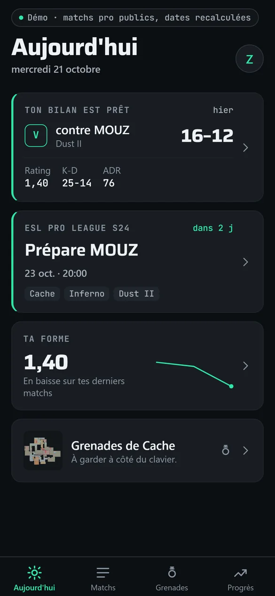
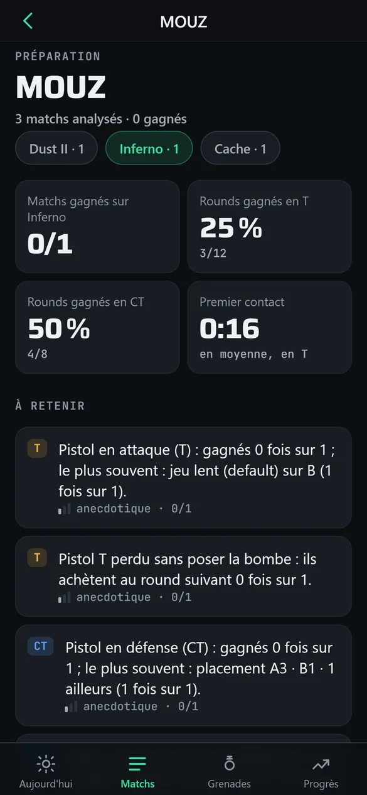
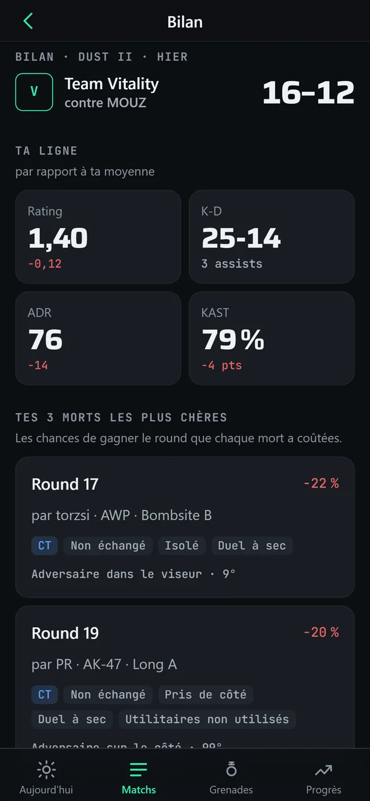
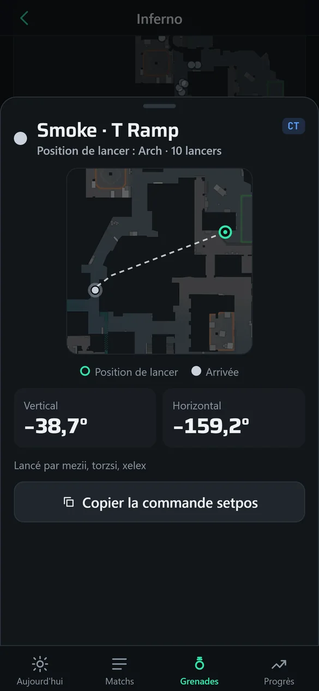

<picture>
  <source media="(prefers-color-scheme: dark)" srcset="./assets/header/banner-dark.svg">
  
</picture>

  
  
  
  

## 👋 Hi, I’m Paul

**AI engineer with a cybersecurity background.** I turn everyday needs into practical web applications, with a focus on clear interfaces, useful features and deployable products. My personal projects combine product exploration, hands-on iteration and AI-assisted development.

- 🎓 Cybersecurity engineering at **ISEP**, Paris (class of 2026), with an Erasmus semester at ISCTE Lisbon in machine learning and computer science.
- 💼 Final-year internship at **Good iD**, a Google partner integrator: two internal tools in production, for customer support and inventory.
- 📦 Earlier internship at **The Lost Recordings**: a Node.js service that requests La Poste shipping slips as soon as an order is ready.
- 🤖 I work with AI coding agents (Claude Code, Codex): I shape the product and the specs, they write the code, I review, test and ship it.
- 🔎 Looking for an AI engineering, software, cloud or cybersecurity role, in France or abroad.

## ✨ Featured projects

- 🎯 **[Sightline](#-sightline)**: Counter-Strike 2 demo analysis platform 🟢 In production for my esports team · 📂 public code
- 📱 **[Sightline mobile](#-sightline-mobile)**: its pocket companion, on the web and Android 🟢 Live · 📂 public code
- 📚 **[Mangathèque](#-mangathèque)**: self-hosted manga reader for my household 🟢 Live · 🔒 private code
- 📒 **[Caderno](#-caderno)**: Portuguese-learning notebook 🟢 Live, password access · 📂 public code
- 🛒 **[AI-built e-commerce shops](#-ai-built-e-commerce-shops)**: Shopify shops coded and illustrated by AI 🟢 First paid orders in Sept. 2026 · 🔒 private
- 🚧 **[Up next: CS2 training servers](#-upcoming--cs2-training-servers-for-my-team)**: on-demand practice servers for my team, the training side of Sightline 🟡 In planning, November 2026

### 🎯 Sightline

**A Counter-Strike 2 demo analysis platform, in production for my esports team.**

Import match demos and get a 2D and 3D replay, team and player analytics, scouting reports and an AI assistant that answers questions about the team's own matches.

🔗 [Explore the project and source code →](https://github.com/BoooJ/sightline)

- ⚙️ FastAPI (Python) backend that parses demos into 32 Hz replays, SQLite with migrations, Docker deployment.
- 🖥️ React and TypeScript interface, with a WebGL (three.js) 3D replay: maps exported from the game, animated player models and ragdoll physics computed in a Web Worker.
- 🤖 AI assistant (Claude or Gemini) grounded on the team's match data.
- 🔌 Integrations: n8n automations, a Chrome extension, a TeamSpeak plugin in C++ and a mobile app.
- ✅ 1,400+ automated tests, run in CI on every push.

🧭 **My role:** defining the product with my team, prioritizing features and directing the work with AI coding assistance (specs, test-first plans, independent reviews), then deploying and running it in production. The repository explains the architecture and how it was built.

### 📱 Sightline mobile

**The pocket companion to Sightline, designed around the moments a player actually picks up their phone.**

Before the match, prepare for the opponent; right after it, read your own debrief; during practice, keep a map's grenades in view next to the keyboard; over time, follow your progress. Same accounts and same data as the web app, plus a notebook for the team's strategies and personal notes.

🔗 [Explore the source code →](https://github.com/BoooJ/sightline/tree/main/mobile) (the `mobile/` folder of the Sightline repository)

  
  
  
  

Demo mode, iPhone format: public professional matches embedded in the app, no account needed.

- 🧱 Expo SDK 58, React Native and expo-router in TypeScript, with TanStack Query and Reanimated.
- 📲 One codebase, two free channels: an installable web app served by the Sightline backend, and an Android APK built in the cloud with EAS. No app-store fees.
- ⏱️ A home screen that knows what moment it is: the next match comes first with a countdown, and a debrief less than 24 hours old goes ahead of everything else.
- 📊 Opponent prep where every figure shows its reliability and sample size, so two rounds are never presented as a trend.
- 📐 Grenade lineups made for a phone propped next to the keyboard: the screen stays on, the angles are large and the practice command copies in one tap.
- 🗓️ Upcoming matches with the opponent's likely maps, shown in each team member's local time.
- ♿ Accessible by design: screen-reader labels, a one-sentence summary for every chart, and simple fades instead of motion when the user asks for less animation.
- 🧪 Unit tests on the app's logic (Vitest), and a demo that weighs about 400 KB of embedded data.

🧭 **My role:** product and UI/UX design (moments of use, screens, visual system), the specification, verification and release. The code is written by AI agents (Claude Code); the first version went live in two days.

### 📚 Mangathèque

**A self-hosted manga reader for my household, installable on iPhone, iPad and PC.**

Search a public manga catalogue, read in manga (right-to-left), page or vertical-scroll mode, download chapters to read offline in airplane mode, and export them as CBZ or PDF. Each family member has their own account and their own downloads.

🔒 *Private repository — I'm happy to walk through the code and architecture on request.*

- 🧱 SvelteKit 2 and Svelte 5 in strict TypeScript, Node 24 and SQLite, packaged as a Docker image and served over HTTPS behind Caddy.
- 🛡️ Deployed on a VPS that already runs another production app: verified backups, config validation before reload and a before/after state check, so that app never went down.
- 🚦 A server-side proxy that plays fair with the content API: rate limiters, automatic pause when asked to slow down, a circuit breaker and a size-capped image cache.
- 📲 Installable PWA: service worker, per-user offline downloads in IndexedDB that resume where they stopped.
- 📄 CBZ and PDF exports streamed page by page, to stay within a 512 MB memory limit.
- 🔐 Security by default: scrypt password hashing, `__Host-` session cookies, login rate limiting and a strict Content Security Policy.
- 🧪 About 600 unit tests (Vitest) and end-to-end browser tests (Playwright) against a fake API server, so no test ever hits the real service.

🧭 **My role:** defining the need and taking every product decision, then directing an AI-driven workflow end to end: a design document checked by six independent AI reviewers, a shared contract and a 14-task test-first plan (about 350 steps), one coding agent per task followed by an independent review agent, and a step-by-step production deployment run from my own machine, with the server keys never leaving it.

### 📒 Caderno

**A personal Portuguese-learning notebook, inspired by life in Brazil.**

Translate between French and Brazilian Portuguese, save useful vocabulary, add personal notes and look up verb conjugations from a mobile-friendly interface.

🔗 [Explore the project and source code →](https://github.com/BoooJ/caderno)

- 🖥️ React and TypeScript interface, designed for mobile and desktop.
- 🗄️ Express API and persistent SQLite storage.
- 📖 60 built-in verbs, custom verb imports and notebook export.
- 📲 PWA with offline reading of previously loaded content.
- 🧪 Automated tests and a Docker deployment setup.

🧭 **My role:** defining the problem, shaping the product, prioritizing features and iterating on the result with AI coding assistance. The repository explains the implementation, trade-offs and current limitations.

### 🛒 AI-built e-commerce shops

**Shopify dropshipping shops whose code and visuals are produced by AI, with every release still under my control.**

Since August 2026 I have been launching Shopify shops on small European markets, in languages I do not always speak. AI coding agents write the theme code and image and video models produce the ad visuals. I decide what gets built, review and test every release, and run the shops.

🔒 *Private work — products, suppliers, pricing and the marketing playbook are intentionally left out. The diagrams below show how the work is organised and checked.*

🟩 In green, the steps I never delegate.

<picture>
  <source media="(prefers-color-scheme: dark)" srcset="./assets/ecommerce/agents-dark.svg">
  
</picture>

<picture>
  <source media="(prefers-color-scheme: dark)" srcset="./assets/ecommerce/release-loop-dark.svg">
  
</picture>

<picture>
  <source media="(prefers-color-scheme: dark)" srcset="./assets/ecommerce/verification-dark.svg">
  
</picture>

- 📜 Working rules written for the agents: nothing goes live without my approval; one file at a time, so the shop settings are never overwritten; a full copy of the live theme before every batch; nothing private in the files served; credentials, bank details and identity handled by me alone.
- 🔍 Pre-launch audit: 29 URLs returning the expected 200, 301 and 404 responses, 293 resources loaded across three pages without a single 404, and no third-party scripts.
- ⚡ Lighthouse mobile, in lab conditions: accessibility 100, SEO 100, performance between 52 and 76.
- 🌍 Domains, payments and translated versions live in September 2026, and the first real, paid orders the same month.

🧭 **My role:** choosing products, markets and pricing; writing the specifications and arbitrating trade-offs; setting up domains, payments and shop settings; testing every release; art-directing the ads, generated by AI and then edited. The code is written by AI agents (Claude Code, Codex).

## 🚧 Upcoming — CS2 training servers for my team

**On-demand Counter-Strike 2 practice servers with training modes, built for my esports team: the training side of Sightline.**

Sightline shows the team what went wrong in a match; this project gives each player a private server to work on it. From a web dashboard, a player picks a mode and a map, starts a server and joins in one click, and the session results come back to the dashboard.

🗓️ *In planning: specification and observation phase, November 2026.*

- 🧩 Training modes driven by one scenario engine (spawns, bot behaviour, weapons, reset and win conditions) and per-map data files, instead of one plugin per mode: aim, prefire, retakes, spray transfer, AWP and grenade practice.
- 🔌 Game-server plugins in C# on CounterStrikeSharp (Metamod), talking to the web backend for access control and session stats.
- 🖥️ Web dashboard with Steam sign-in, a team allowlist and live server status; servers start on demand and stop when idle to keep hosting costs low.
- 🏗️ Built first against a local CS2 dedicated server; team hosting chosen once the first modes are measured (managed CS2 hosting or a dedicated machine).
- ➡️ Next step after that: link Sightline's match analysis to recommended training modes.

🧭 **My role:** studying how existing training platforms behave from a player's point of view, writing the specification for each mode, choosing the hosting, and directing the AI-assisted build and tests.

## 🧰 What these projects are built with

🤖 **AI** &nbsp;   

🖥️ **Front end** &nbsp;      

⚙️ **Back end and data** &nbsp;     

🚀 **Ship and test** &nbsp;     

🔌 **Automation and commerce** &nbsp;   

## 💡 What I value

- 🎯 Building around a real user need.
- 📱 Keeping interfaces understandable and comfortable on a phone.
- 📦 Making personal data portable.
- 📝 Documenting what works, what is tested and what still needs improvement.

## 📫 Get in touch

The best place to start is my [portfolio](https://boooj.github.io/en/): each project page sets out the context and my exact role, and my internship tools come with a mock-up you can try. You can also find me on [LinkedIn](https://www.linkedin.com/in/morel-paul).
